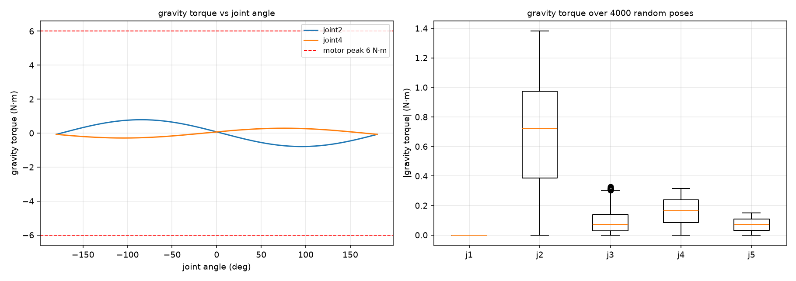
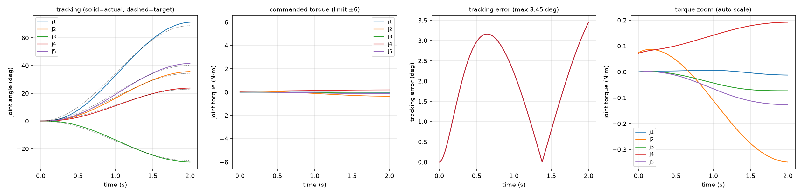

# 动力学仿真（真机模型 arm_real）

> 基于 2026-10-29 SolidWorks 导出的 URDF（含质量/质心/惯量），纯数值仿真，**不驱动真机**。

## 一句话结论

这台臂**重力负担很轻**：最费力的 joint2 在任意姿态下最多只需 **1.38 N·m**，而电机低速段能出 **6 N·m**，余量 4 倍多。质量矩阵的条件数高达 **3755**（joint1/3/5 共轴的后果），这才是控制上要小心的地方。

---

## 一、质量分布

| 连杆 | 质量 | 质心 (m) |
|---|---|---|
| base_link | 0.103 kg | (0.0005, -0.0008, 0.0155) |
| Link1 | 0.013 kg | (-0.0089, -0.0123, 0.0604) |
| Link2 | 0.016 kg | (0.0439, 0.0504, -0.0109) |
| Link3 | 0.015 kg | (-0.0274, 0.0018, 0.0628) |
| Link4 | 0.039 kg | (-0.0025, 0.0262, 0.0105) |
| Link5 | 0.015 kg | (-0.0375, 0.0079, 0.0565) |
| **Link6** | **1.653 kg** | (0.0555, -0.0221, -0.1127) |
| **合计** | **1.854 kg** | - |

**末端 Link6 占了 89% 的质量** —— 它是电机 + 夹爪那一坨。所以动力学上真正决定负载的是末端那段，而不是中间的连杆。

## 二、质量矩阵（零位）

    M(0) =
    [+0.00192 +0.00001 +0.00188 -0.00118 +0.00182]
    [+0.00001 +0.01510 -0.00005 +0.01002 -0.00022]
    [+0.00188 -0.00005 +0.00187 -0.00116 +0.00181]
    [-0.00118 +0.01002 -0.00116 +0.01183 -0.00110]
    [+0.00182 -0.00022 +0.00181 -0.00110 +0.00178]

特征值：6.3e-6, 2.1e-5, 2.6e-3, 6.1e-3, 2.4e-2，**条件数 3755**。

原因很直白：joint1、joint3、joint5 **都是竖直轴**，它们对末端惯量的贡献几乎一样，所以矩阵的前三行几乎相同。后果：

1. 控制器用固定增益（PID）时，最小特征值方向上的等效阻尼 ≈ Kd / λmin ≈ 1e6 /s，**必须用很小的时间步长或很低的增益**；
2. 所以我这里用了**计算力矩控制**：τ = M·(Kp·e + Kd·ė) + C + G，把 M 除掉了，闭环变成干净的 q̈ = Kp·e + Kd·ė。

## 三、重力力矩（能不能自己撑住）

| 关节 | 全空间最大 | 平均 |
|---|---|---|
| joint1 | **0.000 N·m** | 0.000 |
| joint2 | **1.381 N·m** | 0.688 |
| joint3 | 0.327 N·m | 0.091 |
| joint4 | 0.317 N·m | 0.161 |
| joint5 | 0.151 N·m | 0.072 |

**joint1 的重力力矩严格为 0** —— 这正好验证了模型：它是竖直轴，重力不产生绕它的力矩。

结论：**重力不是瓶颈**。电机低速段 6 N·m，最费的 joint2 也只用 1.38 N·m。

## 四、轨迹跟踪仿真

设定：从零位走到 [1.2, 0.6, -0.5, 0.4, 0.7] rad，2 秒余弦轨迹，控制律 τ = M(Kp e + Kd ė) + C + G，力矩上限 ±6 N·m，RK4 步长 1 ms。

| 指标 | 结果 |
|---|---|
| 峰值力矩 | **[0.012, 0.349, 0.073, 0.192, 0.127] N·m** |
| 峰值速度 | [1.01, 0.50, 0.42, 0.34, 0.59] rad/s（约 9.6 / 4.8 / 4.0 / 3.2 / 5.6 RPM） |
| 最大跟踪误差 | **3.45°**（Kp=25、Kd=10 时） |
| 力矩上限有没有触到 | **没有**，最大 0.35 N·m，占上限 6% |

跟踪误差主要来自控制增益偏低（Kp=25 大约相当于 5 rad/s 的带宽），不是力矩不够。要更准就把 Kp 提高。

## 五、这个模型的边界

| 包含的 | 不包含的 |
|---|---|
| 质量、质心、转动惯量 | 关节摩擦、减速箱回差 |
| 重力、科氏、惯性耦合 | 电机电流环、编码器噪声 |
| 刚体假设 | 连杆弹性、线缆拖拽 |

所以：**力矩结论（1.38 N·m 的重力）可信**，因为那部分只取决于质量和几何；**实际需要的力矩会比仿真的 0.35 N·m 大**，加上摩擦和余量，估计 0.5~1 N·m 量级 —— 仍然远小于 6 N·m。

## 六、对实际控制的建议

1. **可以放心做重力补偿**：G 最大才 1.38 N·m，实时算出来补上很划算，能大幅减小静止时的下垂；
2. **别用高增益 PID 硬怼**：质量矩阵条件数 3755，高增益会放大共轴方向的噪声；用计算力矩或低增益加前馈；
3. **joint2 是主要负载**：它扛着末端 1.65 kg 的力臂，限流要留够（现在 6 A 对应约 6 N·m，够用）；
4. **末端减重收益最大**：Link6 占 89% 质量，换轻一点的夹爪，重力力矩几乎线性下降。
