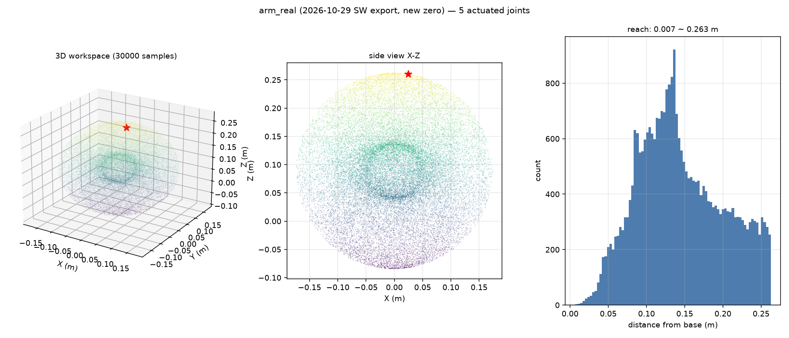

# 正逆运动学分析（真机模型）

> 基于 **arm_real**：你 2026-10-29 用 SolidWorks SW2URDF 导出的模型，零位已烘成现在这台机器人的实际姿态。
> 只算数学，不驱动电机。

## 一句话结论

这台臂的末端能到达一个**半径 26.3 cm 的球**（最近能收到 0.7 cm，几乎贴到底座）。5 个主动关节（joint6 没有电机）足够做位置控制：**逆解 40/40 全部成功，位置误差中位 0.1 mm**。

---

## 一、运动链（零位时的真实数据）

    关节      轴（世界系，零位）              关节原点（世界系 m）           限位
    joint1  [+0.000 +0.000 +1.000]        [+0.0000 +0.0000 +0.0030]    ±180°
    joint2  [-0.999 +0.034 -0.000]        [+0.0790 -0.0027 +0.0890]    ±180°
    joint3  [+0.000 +0.002 +1.000]        [+0.0008 -0.0001 +0.0740]    ±180°
    joint4  [-0.998 +0.067 -0.000]        [+0.0228 -0.0014 +0.1522]    ±180°
    joint5  [+0.000 +0.002 +1.000]        [+0.0028 +0.0000 +0.1822]    ±180°
    joint6  [-1.000 +0.013 +0.000]        [+0.0248 -0.0001 +0.2604]    ±180°  （无电机）

**轴的分布很有规律**：joint1/3/5 都是**竖直轴**（0,0,±1），joint2/4 都是**水平轴**（±1,0,0）。交替排列，像折臂式的结构。

**零位末端**：`[0.0248, -0.0001, 0.2604]` m —— 在底座正上方 **26 cm**。

## 二、工作空间

| | 数值 |
|---|---|
| 到原点距离 | **0.007 ~ 0.263 m**（平均 0.143） |
| X 范围 | −0.172 ~ +0.173 m |
| Y 范围 | −0.172 ~ +0.170 m |
| Z 范围 | −0.084 ~ +0.263 m |

侧视图看得最清楚：能到达的区域是一个**以底座附近为中心的球**，最远 26.3 cm，最近几乎能收回到底座（0.7 cm）。

中间那圈的密度分布（右图）说明大部分姿态集中在 10~15 cm 半径处。

## 三、奇异位形

用雅可比矩阵的条件数衡量（越大越接近奇异）：

| 指标 | 数值 |
|---|---|
| 条件数中位数 | **89** |
| 90% 分位 | 441 |
| 最大 | 10669 |
| 接近奇异（条件数 > 200）的位形占比 | **25%** |

比之前用错模型算的 48.7% 好很多——真机的结构更“开阔”，四分之一的位置不好控制，其余 75% 都好用。

> 结构上 joint1/3/5 共轴（都是竖直轴），当它们接近共线时就会接近奇异。

## 四、逆运动学

算法：**阻尼最小二乘 + 关节限位 + 多初值**。

    成功率        100%（40/40 个随机可达位姿）
    位置误差中位  0.0000 ~ 0.0001 m
    最大误差      0.0001 m

例子：

    目标关节角  [0.500, 0.400, -0.300, 0.200, 0.300]
    逆解结果    [0.499, 0.400, -0.297, 0.200, 0.298]
    两次正解末端差 0.000014 m

## 五、和之前那份分析的差别

之前我误用了最初上游仓库里的通用臂模型（`arm_urdf`），那份的数据全部作废：

| | 旧模型（作废） | 真机 arm_real |
|---|---|---|
| 零位末端 | [0.025, −0.004, 0.260] | [0.0248, −0.0001, 0.2604] |
| 最大可达 | 0.344 m | **0.263 m** |
| 条件数中位 | 189 | **89** |
| 奇异占比 | 48.7% | **25%** |

（零位末端看着接近，是因为我按你的姿态把零位烘过了；但模型几何本身完全不同。）

## 六、怎么自己跑

    cd ~/ros2_arm_ws/src/arm_urdf/tools
    ARM_URDF=~/ros2_arm_ws/src/arm_real/urdf/arm_real.urdf python3 kinematics.py

## 七、这台臂的限制

1. **joint6 没有电机**：末端只有 5 个主动自由度，6 维位姿（3 位置 + 3 姿态）不可能全部控制。逆解里姿态权重只给 0.15（位置优先）；要严格控姿态必须给 joint6 装电机。
2. **joint1/3/5 共轴**：三者接近共线时是奇异位形，约占四分之一；实际使用避开伸直/完全折叠的姿态即可。
3. **工作半径只有 26 cm**：这是个小臂，不是工业六轴，负载和精度都要按这个量级预期。
