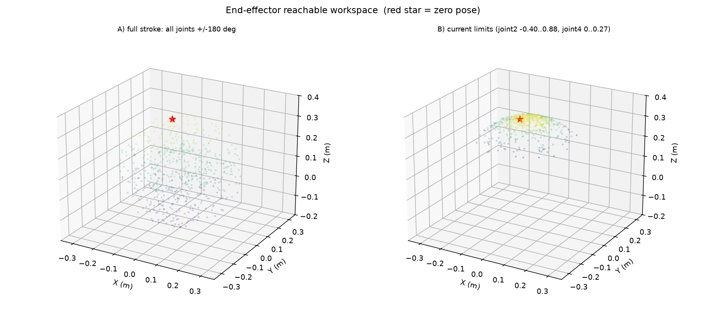

# 正逆运动学分析

> 只算数学，不碰真机。全部基于当前 URDF（零位已经烘成这台机器人的实际姿态）。

## 一句话结论

这台臂**能到的地方像一个半径 34 cm 的扁球**，但**现在 joint2 只放开 ±30°、joint4 只有 16°，等于把它锁成一块刚体**——手几乎只能在一个 4 cm 的薄盘面上动。逆解本身很好用：40 个随机目标 100% 解出，位置误差 0.1 mm。

---

## 一、先分清两个方向

| | 输入 | 输出 | 比喻 |
|---|---|---|---|
| **正运动学 (FK)** | 每个关节转多少度 | 手（末端）在空间里的位置和朝向 | 知道每个关节的角度，算出手伸到哪儿 |
| **逆运动学 (IK)** | 手要到哪儿 | 每个关节该转多少度 | 把手按到那个点，反推每个关节要转几度 |

前者是**唯一确定的**（同一组角度只有一个位置）；后者**可能有很多解，也可能无解**（手够不到就解不出来），所以要靠迭代。

## 二、这台臂的运动链

从底座 base_link 一路到末端 Link6，6 个关节（其中 joint6 **没有电机**，只能跟着动）：

    关节       轴（世界系）                关节原点（m）                 当前限位
    joint1   [ 0.000,  0.000,  1.000]   [ 0.000,  0.000, -0.016]   ±180°      绕竖直轴转（底座）
    joint2   [ 1.000, -0.000, -0.000]   [ 0.058,  0.000,  0.087]   -23°..+50° 绕 X 轴（肩）
    joint3   [-0.000, -0.001, -1.000]   [-0.029,  0.000,  0.076]   ±180°      绕竖直轴（肘，竖直轴！）
    joint4   [-0.014,  1.000, -0.001]   [-0.029,  0.012,  0.163]   -0°..+16°  绕 Y 轴（腕1）
    joint5   [ 0.011,  0.001,  1.000]   [-0.028, -0.009,  0.253]   ±180°      绕竖直轴（腕2）
    joint6   [ 0.049, -0.999,  0.001]   [-0.026, -0.020,  0.340]   ±90°      绕 Y 轴（无电机）

**零位时末端在哪**：[-0.026, -0.020, 0.340] m —— 手在底座正上方 **34 cm**，几乎竖直立着。

## 三、工作空间（手能到哪儿）

| | 满行程（全部 ±180°） | 当前限位 |
|---|---|---|
| 到原点距离 | **1.6 cm ~ 34.4 cm** | 30.1 cm ~ 34.4 cm |
| X 范围 | −0.259 ~ 0.252 m | −0.215 ~ 0.224 m |
| Y 范围 | −0.258 ~ 0.258 m | −0.218 ~ 0.216 m |
| Z 范围 | −0.166 ~ 0.341 m | **0.198 ~ 0.341 m** |

左图是机构真正的能力：能收到底座附近（1.6 cm），也能伸到 34 cm，高度从 −17 cm 到 +34 cm。
右图是**现在**：一个薄盘（Z 只从 0.198 到 0.341），因为 joint2 和 joint4 被限死在很小的角度里。

**这就是为什么拖滑块感觉动不了多少** —— 不是电机没力，是软件把关节夹住了。

## 四、奇异位形（为什么“不好用力”的地方多）

**奇异位形** = 手臂伸直或完全叠起来的那种姿态：这时候某些方向的手部运动需要关节转无穷大，控制器会突然解不出来或者猛冲。

用**雅可比矩阵的条件数**衡量：数值越大越接近奇异。

| | 条件数中位 | 90% 分位 | 条件数 > 200 的位形占比 |
|---|---|---|---|
| 满行程 | 189 | 1656 | **48.7%** |
| 当前限位 | 1095 | 6443 | **99.0%** |

现在几乎 100% 的位形都接近奇异——因为关节被限死，手臂只能在一个近乎刚性的状态里微调，雅可比的部分行几乎线性相关。**放开 joint2 和 joint4 之后这个比例会掉到一半左右。**

> 结构上：joint3 的轴和 joint5 的轴都是竖直方向（[0,0,−1] 和 [0,0,+1]），两者容易共线，是这台臂主要的奇异来源。

## 五、逆运动学：怎么解、解得准不准

用的是**阻尼最小二乘（Damped Least Squares）**，可以理解成：

> 每次先看“手离目标还差多少”，再解“关节该转多少才能补上这个差”，但转的幅度先打个折（阻尼），避免在奇异附近一步跳太远；每一步都夹在关节限位里；再换几个不同起点重试，取误差最小的。

实测（40 个随机可达位姿，每例 3 个初值）：

    成功率        100%
    位置误差中位  0.0001 m（0.1 mm）

一个具体例子：

    目标关节角  [0.600, 0.500, 0.400, 0.300, 0.200, 0.000]
    逆解结果    [0.599, 0.500, 0.397, 0.300, 0.198, 0.000]
    末端位置差  0.000017 m

## 六、怎么自己跑

    cd ~/ros2_arm_ws/src/arm_urdf/tools
    python3 kinematics.py            # 需要 numpy

会打印上面的表，并生成 `kin/report.txt`、`kin/workspace.png`、`kin/summary.json`。

## 七、这台臂的两个硬限制（要记着）

1. **joint6 没有电机**：末端只有 5 个主动自由度 + 1 个被动，所以 6 维位姿（3 位置 + 3 姿态）**不可能全部控制**。逆解里给姿态加了 0.15 的权重（位置优先）；要严格控姿态得先把 joint6 装上电机。
2. **轴线分布不均匀**：joint3 和 joint5 都是竖直轴，接近共线时就是奇异位形。这是结构原因，不是标定问题。

## 八、下一步可以做的

- 把 joint2 / joint4 的限位放开后重跑一次，能看到工作空间和条件数的真实改善；
- 把逆解接成 ROS 服务（给一个目标点，返回关节角），或者生成 MoveIt 配置做规划；
- 想做轨迹的话，可以先在这个运动学模型上做，不用碰真机。
